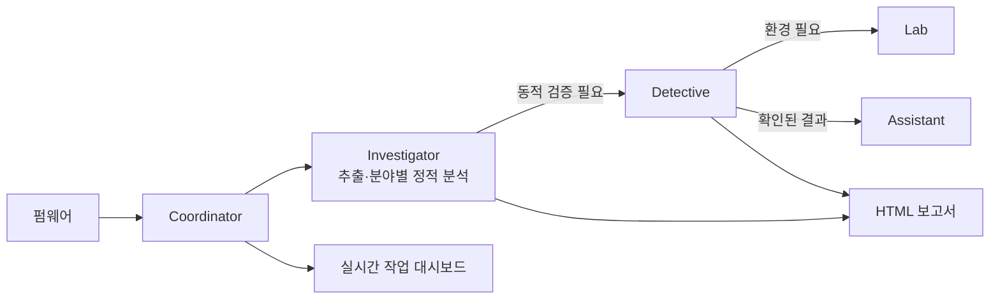

# FBI 2.0 (Firmware Binary Inspector)

FBI는 펌웨어를 추출하고 취약점 후보를 조사하는 Codex 기반 분석 도구입니다. 전담 Investigator가 분야별로 정적 분석을 수행하고, 실행 확인이 필요한 후보는 Detective가 이어서 검증합니다. 분석 과정과 결과는 로컬 세션, 작업 대시보드, 한국어 HTML 보고서로 확인할 수 있습니다.

## 주요 기능

- Binwalk와 `unsquashfs`를 이용한 펌웨어 및 내부 파일시스템 추출
- 고정된 10개 보안 분야별 Investigator 조사
- 발견사항에 따른 Detective 검증과 선택적 Lab·Assistant 연계
- 작업 상태 저장, 중복 실행 방지, 중단 후 재개
- 실시간 작업 그래프와 근거 중심 HTML 보고서

## 분석 흐름



| 전담 분야 | 조사 대상 |
| --- | --- |
| 비밀정보 | 하드코딩 자격증명과 개인키 |
| 스택 오버플로 | 스택 버퍼와 입력·쓰기 경로 |
| 메모리 안전성 | 범위·정수·수명 오류 |
| 서비스 거부 | 자원 소모와 서비스 중단 |
| 입력 처리 | 명령 실행과 입력 검증 |
| 인증·권한 | 로그인·세션·접근 제어 |
| 업데이트 신뢰 | 서명·무결성·롤백 검증 |
| 암호화·통신 | 암호 설정과 전송 보안 |
| 외부 구성요소 | 제품·버전·설정과 CVE 적용 여부 |
| 노출·권한 설정 | 서비스 노출과 특권 실행 |

## 시작하기

Python 3.10 이상과 인증된 Codex CLI가 필요합니다. 추출에는 `binwalk`가 필요하며, SquashFS 내부 파일을 분석하려면 `unsquashfs`도 설치해야 합니다. 동적 검증에는 대상 아키텍처에 맞는 QEMU가 필요할 수 있습니다.

```bash
# 통합 분석
python3 coordinator/main.py path/to/firmware.bin

# 별도 터미널에서 작업 그래프 보기
python3 coordinator/dashboard.py path/to/firmware.bin

# 저장된 세션으로 보고서 다시 만들기
python3 report_generator.py --session path/to/investigator-session
```

통합 분석은 기본적으로 한 번에 전담 작업 60건까지 시작합니다. 같은 명령을 다시 실행하면 남은 작업을 이어갑니다. 외부 구성요소의 공식 자료 조회는 `--allow-network-research`를 지정했을 때만 수행합니다. 각 명령의 나머지 옵션은 `--help`에서 확인할 수 있습니다.

보고서는 **정적 근거 확인**, **동적 검증 필요**, **재현 확인**을 구분합니다. `적용 단서 없음`은 취약점이 없다는 판정이 아닙니다. 생성되는 세션과 보고서는 `.gitignore`에 등록되어 있습니다.

## 문서

- [Coordinator와 실시간 대시보드](coordinator/README.md)
- [Investigator와 전담 분야](investigator/README.md)
- [Detective](detective/README.md), [Lab](lab/README.md), [Assistant](assistant/README.md)
- [보고서 형식과 검증 기준](REPORT_FORMAT.md)
- [공통 코드](shared/README.md)

## 라이선스

코드와 문서는 [Apache License 2.0](LICENSE)에 따라 배포합니다. 분석 대상 펌웨어와 제3자 자료에는 이 라이선스를 적용하지 않습니다.
