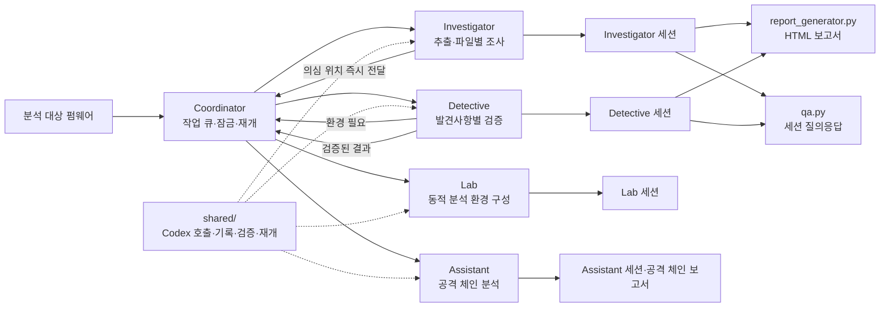
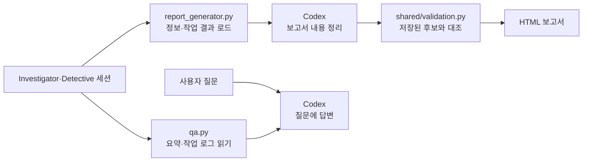

# FBI (Firmware Binary Inspector)

FBI는 Codex CLI로 펌웨어 바이너리를 분석하는 로컬 도구입니다. 통합 실행기는 펌웨어 추출 후 모든 일반 파일을 검토하고, 의심 위치가 기록되는 대로 Detective 검증을 시작합니다. 필요하면 Lab 환경 구성과 Assistant의 공격 체인 분석을 연결합니다. 각 단계의 결과는 세션과 한국어 HTML 보고서에 남습니다.

## 구성

| 경로 | 역할 |
| --- | --- |
| [`coordinator/`](coordinator/README.md) | 전 파일 검토와 단계별 작업 큐·잠금·재개를 관리하는 통합 실행기 |
| [`investigator/`](investigator/README.md) | 펌웨어 정보 수집, 패치 비교, 정적 분석 작업 분배 |
| [`detective/`](detective/README.md) | 조사 결과 검증, 선택적 QEMU 실행, 재현 절차 작성 |
| [`lab/`](lab/README.md) | 에뮬레이션 및 디버깅 환경 구성 |
| [`assistant/`](assistant/README.md) | Detective 결과를 바탕으로 공격 체인 분석 및 스크립트 생성 |
| [`shared/`](shared/README.md) | Codex 실행, 세션 로그, MCP 설정 등 공통 코드 |
| `qa.py` | 저장된 세션을 사용한 질의응답 |
| `report_generator.py` | 세션 기반 한국어 HTML 보고서 생성 |
| [`REPORT_FORMAT.md`](REPORT_FORMAT.md) | 보고서 목차와 검증 상태 기준 |
| [`LICENSE`](LICENSE) | Apache License 2.0 전문 |

## 전체 흐름



통합 명령에서는 Coordinator가 추출 후 모든 일반 파일을 한 개씩 검토하도록 Investigator를 실행합니다. 의심 위치는 저장 즉시 Detective 작업으로 전달됩니다. Detective가 환경 구성을 요청하면 Lab을 한 번 실행해 결과를 공유하고, 확인된 취약점이 생기면 Assistant를 실행합니다. 통합 실행은 모든 작업이 끝난 뒤 HTML 보고서를 한 번 생성합니다. 기존의 Investigator·Detective·Lab·Assistant 개별 명령도 사용할 수 있으며, Investigator와 Detective의 개별 명령은 각자 HTML 보고서를 생성합니다. `qa.py`는 지정한 세션의 로그를 읽어 질문에 답합니다. 내부 흐름은 각 폴더의 README에 있습니다.

### 세션 조회와 보고서



보고서 검증은 세션에 저장된 근거와 후보를 대조합니다. `qa.py`는 현재 작업 로그에서 요약, 일반 발견사항과 일부 분석 내용을 읽으므로 세션 전체를 빠짐없이 검색하는 도구는 아닙니다.

## 준비

- Python 3.10 이상
- 로컬에 설치하고 인증한 `codex` CLI
- `file`, `strings`, `binwalk` 명령. `binwalk`는 분석 전 추출에 필요합니다.
- 동적 분석에는 대상 아키텍처에 맞는 QEMU가 별도로 필요할 수 있습니다.

각 단계의 `settings.json`은 `gpt-6-sol`을 기본 모델로 사용합니다. 오케스트레이션의 추론 수준은 `medium`, 분석 워커는 `high`입니다. `qa.py`와 `report_generator.py`도 기본적으로 `high`를 사용합니다. MCP 서버 목록은 비어 있으며, 필요한 서버는 설정의 `mcp.servers`에 추가할 수 있습니다.

Investigator 워커는 세션 디렉터리를 작업 루트로 삼아 분석 산출물을 작성할 수 있고, Detective·Lab·Assistant 워커도 작업 공간 쓰기 권한으로 실행합니다. 워커의 네트워크 접근은 기본적으로 꺼져 있습니다. Investigator는 `--allow-network-research`로 외부 자료 조회를 허용할 수 있으며, 다른 단계는 해당 `settings.json`의 `worker.network_access`를 변경할 수 있습니다. 세션을 재개할 때도 같은 권한 설정이 적용됩니다. 워커 결과의 `evidence`는 관찰 근거, `inferences`는 아직 검증되지 않은 해석을 뜻합니다.
Investigator·Lab·Assistant의 재개 실행은 기존 세션 디렉터리에 작업 결과를 이어서 기록합니다. Investigator와 Lab은 펌웨어 SHA256이 이전 세션과 일치하는지 확인합니다.
Investigator는 기본 정보 수집 후 세션의 `extracted/`에 펌웨어를 추출합니다. 실제 추출 파일이 확인되면 그 경로를 오케스트레이터와 워커에 전달해 분석을 시작합니다. 추출 도구가 없거나 추출 결과가 비어 있으면 분석을 시작하지 않고 `extraction.json`에 이유를 기록합니다. 재개할 때는 검증된 추출 결과를 다시 사용합니다.

## 실행

저장소 루트에서 실행합니다. 아래의 `path/to/firmware.bin`은 사용자가 별도로 준비한 분석 대상 파일입니다.

```bash
# 통합 실행: 전 파일 검토와 발견사항별 후속 검증
python3 coordinator/main.py path/to/firmware.bin

# 동시 작업 수 조정, 외부 1차 자료 조회 허용
python3 coordinator/main.py path/to/firmware.bin --investigator-workers 3 --detective-workers 2 --allow-network-research

# 기존 개별 실행 명령
python3 investigator/main.py path/to/firmware.bin

# 약 45분의 리서치 시간 예산을 지정
python3 investigator/main.py path/to/firmware.bin --research-minutes 45

# 패치된 버전과 비교
python3 investigator/main.py path/to/old-firmware.bin --patched path/to/new-firmware.bin

# 저장된 조사 결과로 후속 검증
python3 detective/main.py --session path/to/investigator-session --no-qemu

# 세션 기반 질의응답 및 보고서 재생성
python3 qa.py --session path/to/session "분석 결과를 요약해줘"
python3 report_generator.py --session path/to/session
```

`main.py`는 기존 명령 호환용 진입점이며 `investigator/main.py`로 연결됩니다. 각 명령의 옵션은 `--help`에서 확인할 수 있습니다.

통합 실행 상태는 `sessions/coordinator/<펌웨어 SHA256>/pipeline_status.json`에 기록됩니다. 같은 펌웨어를 다시 실행하면 저장된 Investigator 세션과 미완료 작업을 복원합니다. `first_detective_start_seconds`는 통합 실행 시작부터 첫 Detective 작업까지, `elapsed_seconds`는 연계 작업 완료까지의 시간이며 최종 보고서 재생성 시간은 포함하지 않습니다. 두 값은 실제 펌웨어와 실행 환경에 따라 달라집니다.

2026-10-25 로컬 모의 작업 측정(`python3 benchmark_coordinator.py`): 파일 발견 4건, 파일별 지연 0.04초, Detective 지연 0.08초, Detective 동시 실행 2개에서 첫 Detective 시작은 0.044~0.051초, 연계 작업 완료는 0.277~0.315초였습니다. 작업 지연만 순차 합산한 기준값은 0.48초입니다. 이 값은 스케줄링 검사용이며 실제 펌웨어·Codex·QEMU 처리 속도를 예측하지 않습니다.

실행 중 생성되는 `sessions/`, `report/`, `poc_artifacts/`, `kill_chain_artifacts/` 등은 `.gitignore`에 등록되어 있습니다. 분석 대상 바이너리와 분석 결과를 공개하려면 권리 및 민감정보를 별도로 확인하세요.

## 라이선스

저장소의 코드와 문서는 [Apache License 2.0](LICENSE)에 따라 배포합니다. 분석 대상 펌웨어와 제3자 자료에는 이 라이선스를 적용하지 않습니다.
