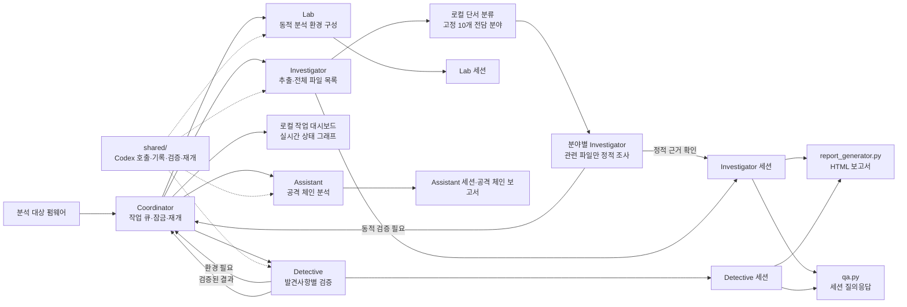
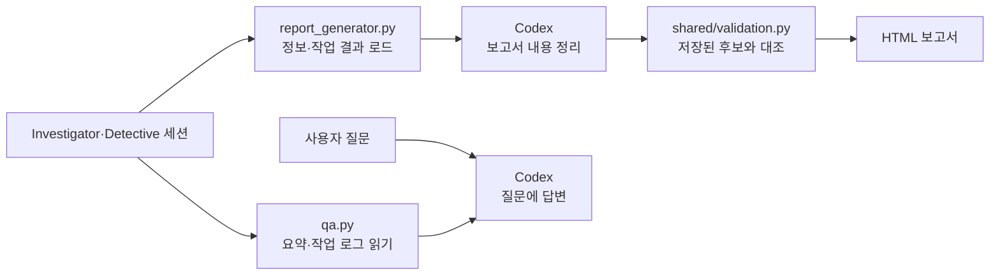

# FBI 2.0 (Firmware Binary Inspector)

FBI는 Codex CLI로 펌웨어 바이너리를 분석하는 로컬 도구입니다. 통합 실행기는 펌웨어 추출 후 모든 파일을 목록화하고 고정된 10개 전담 분야에 관련 파일을 배정합니다. 실행 검증이 필요한 발견사항은 즉시 Detective로 전달하고, 필요하면 Lab과 Assistant를 연결합니다. 각 단계의 결과는 세션과 한국어 HTML 보고서에 남습니다.

## 구성

| 경로 | 역할 |
| --- | --- |
| [`coordinator/`](coordinator/README.md) | 전 파일 검토와 단계별 작업 큐·잠금·재개를 관리하는 통합 실행기 |
| [`investigator/`](investigator/README.md) | 펌웨어 정보 수집, 패치 비교, 정적 분석 작업 분배 |
| [`detective/`](detective/README.md) | 조사 결과 검증, 선택적 QEMU 실행, 재현 절차 작성 |
| [`lab/`](lab/README.md) | 에뮬레이션 및 디버깅 환경 구성 |
| [`assistant/`](assistant/README.md) | Detective 결과를 바탕으로 공격 체인 분석 및 스크립트 생성 |
| [`shared/`](shared/README.md) | Codex 실행, 세션 로그, MCP 설정 등 공통 코드 |
| `qa.py` | 저장된 세션을 사용한 질의응답 |
| [`report_generator.py`](report_generator.py) | 세션 기반 한국어 HTML 보고서 생성 |
| [`report_assets/`](report_assets/README.md) | 재사용하는 보고서 HTML·CSS 템플릿 |
| [`REPORT_FORMAT.md`](REPORT_FORMAT.md) | 보고서 목차와 검증 상태 기준 |
| [`LICENSE`](LICENSE) | Apache License 2.0 전문 |

## 전체 흐름



통합 명령은 추출된 모든 파일의 유형과 제한된 내용 표본을 로컬에서 확인한 뒤 관련 단서가 있는 전담 Investigator만 실행합니다. 분야 목록은 모든 펌웨어에 동일하며, 단서가 없으면 모델 호출 없이 `적용 단서 없음`으로 기록합니다. 이는 취약점 부재 판정이 아닙니다. 동적 검증이 필요한 위치만 저장 즉시 Detective로 전달됩니다. 정적으로 존재와 사용처가 확인된 비밀정보는 Detective를 기본적으로 호출하지 않습니다. Detective가 환경 구성을 요청하면 Lab을 실행해 결과를 공유하고, 실행 근거로 확인된 취약점이 생기면 Assistant를 실행합니다. 통합 실행은 모든 작업이 끝난 뒤 HTML 보고서를 한 번 생성합니다. 기존 Investigator·Detective·Lab·Assistant 개별 명령도 사용할 수 있습니다. 내부 흐름은 각 폴더의 README에 있습니다.

| 고정 전담 분야 | 담당 |
| --- | --- |
| 비밀정보 | 하드코딩 자격증명, 개인키, 실제 사용처 |
| 스택 오버플로 | 스택 버퍼 크기와 입력·쓰기 경로 |
| 기타 메모리 안전성 | 힙·범위·정수·수명 오류 |
| 서비스 거부 | 독립적인 자원 소모·서비스 종료 원인 |
| 입력 처리 | 명령 주입·경로 조작·위험한 역직렬화 |
| 인증·권한 | 로그인·세션·권한 검사 경계 |
| 업데이트 신뢰 | 서명·무결성·롤백·부팅 검증 |
| 암호화·통신 | 암호 설정·인증서 검증·전송 보안 |
| 외부 구성요소 | 제품·버전·설정·영향 코드와 공식 CVE 자료 |
| 노출·권한 설정 | 서비스 시작·디버그 인터페이스·파일 권한 |

### 세션 조회와 보고서



보고서 검증은 세션에 저장된 근거와 후보를 대조합니다. `qa.py`는 현재 작업 로그에서 요약, 일반 발견사항과 일부 분석 내용을 읽으므로 세션 전체를 빠짐없이 검색하는 도구는 아닙니다.

## 준비

- Python 3.10 이상
- 로컬에 설치하고 인증한 `codex` CLI
- `file`, `strings`, `binwalk` 명령. SquashFS 내부 파일까지 검토하려면 `unsquashfs`도 필요합니다.
- 동적 분석에는 대상 아키텍처에 맞는 QEMU가 별도로 필요할 수 있습니다.

각 단계의 `settings.json`은 `gpt-6-sol`을 기본 모델로 사용합니다. 오케스트레이션의 추론 수준은 `medium`, 분석 워커는 `high`입니다. `qa.py`와 `report_generator.py`도 기본적으로 `high`를 사용합니다. MCP 서버 목록은 비어 있으며, 필요한 서버는 설정의 `mcp.servers`에 추가할 수 있습니다.

Investigator 워커는 세션 디렉터리를 작업 루트로 삼아 분석 산출물을 작성할 수 있고, Detective·Lab·Assistant 워커도 작업 공간 쓰기 권한으로 실행합니다. 워커의 네트워크 접근은 기본적으로 꺼져 있습니다. 통합 실행의 `--allow-network-research`는 외부 구성요소 담당에게만 공식 자료 조회를 허용합니다. 개별 Investigator 명령의 같은 옵션은 기존 워커에 적용됩니다. 다른 단계는 해당 `settings.json`의 `worker.network_access`를 변경할 수 있습니다. 워커 결과의 `evidence`는 관찰 근거, `inferences`는 아직 검증되지 않은 해석을 뜻합니다.
Investigator·Lab·Assistant의 재개 실행은 기존 세션 디렉터리에 작업 결과를 이어서 기록합니다. Investigator와 Lab은 펌웨어 SHA256이 이전 세션과 일치하는지 확인합니다.
Investigator는 기본 정보 수집 후 세션의 `extracted/`에 펌웨어를 재귀 추출합니다. Binwalk가 SquashFS 이미지만 남긴 경우 `unsquashfs`로 내부 파일을 추가 추출합니다. 일부 장치 노드는 일반 사용자 권한으로 복원되지 않을 수 있으며, 그 이유는 `extraction.json`과 보고서에 남깁니다. 추출 도구가 없거나 추출 결과가 비어 있으면 분석을 시작하지 않습니다. 이전 세션의 불완전한 추출도 재개 시 확장합니다.

## 실행

저장소 루트에서 실행합니다. 아래의 `path/to/firmware.bin`은 사용자가 별도로 준비한 분석 대상 파일입니다.

```bash
# 통합 실행: 전담 분야별 검토와 필요한 발견사항의 후속 검증
python3 coordinator/main.py path/to/firmware.bin

# 동시 작업 수와 회차별 전담 작업 한도 조정, 외부 1차 자료 조회 허용
python3 coordinator/main.py path/to/firmware.bin --investigator-workers 3 --detective-workers 2 --max-specialist-tasks 60 --allow-network-research

# 별도 터미널에서 실시간 작업 그래프 열기
python3 coordinator/dashboard.py path/to/firmware.bin

# 기존 개별 실행 명령
python3 investigator/main.py path/to/firmware.bin

# 약 45분의 리서치 시간 예산을 지정
python3 investigator/main.py path/to/firmware.bin --research-minutes 45

# 패치된 버전과 비교
python3 investigator/main.py path/to/old-firmware.bin --patched path/to/new-firmware.bin

# 저장된 조사 결과로 후속 검증
python3 detective/main.py --session path/to/investigator-session --no-qemu

# 세션 기반 질의응답 및 보고서 재생성
python3 qa.py --session path/to/session "분석 결과를 요약해줘"
python3 report_generator.py --session path/to/session
# 저장된 요약을 무시하고 보고서 내용을 다시 요청
python3 report_generator.py --session path/to/session --refresh-summary
```

`main.py`는 기존 명령 호환용 진입점이며 `investigator/main.py`로 연결됩니다. 각 명령의 옵션은 `--help`에서 확인할 수 있습니다.

보고서는 고정된 [`report.html`](report_assets/report.html)·[`report.css`](report_assets/report.css)에 세션 데이터를 채워 생성합니다. Codex는 HTML·CSS를 작성하지 않고 발견사항의 서술 데이터만 JSON으로 반환합니다. 동일한 세션 내용·모델·프롬프트로 다시 생성하면 `report_summary_cache.json`을 재사용해 Codex 호출을 생략합니다. 출력 폴더에 CSS를 함께 복사하므로 HTML 파일을 바로 열 수 있습니다.

통합 실행 상태는 `sessions/coordinator/<펌웨어 SHA256>/pipeline_status.json`에 기록됩니다. 같은 펌웨어를 다시 실행하면 저장된 Investigator 세션과 미완료 작업을 복원합니다. `first_detective_start_seconds`는 통합 실행 시작부터 첫 Detective 작업까지, `elapsed_seconds`는 연계 작업 완료까지의 시간이며 최종 보고서 재생성 시간은 포함하지 않습니다. 두 값은 실제 펌웨어와 실행 환경에 따라 달라집니다.

내부 파일시스템이 큰 펌웨어는 전담 작업이 수천 건으로 늘 수 있습니다. 기본 한도는 실행당 60건이며, 남은 건은 `research_status.json`에 기록됩니다. 같은 통합 명령을 다시 실행하면 미완료 작업부터 이어서 처리합니다. `--max-specialist-tasks 0`은 회차 제한을 해제합니다.

Investigator 세션의 `scan_scope.json`에는 파일별 라우팅 이유, 10개 분야의 적용 상태와 프롬프트 버전, 읽지 못한 파일의 이유가 있습니다. `task_results.jsonl`에는 분야별 작업과 검토 결과가 남습니다. 통합 실행의 `--max-iterations`는 호환성을 위해 유지되며, 현재 전담 분야 모드의 포괄 오케스트레이터 반복에는 사용되지 않습니다. 정적 근거 확인은 코드·설정의 관찰을 뜻하고, `재현 확인`은 기록된 실행 테스트에만 사용합니다. 비밀 값은 저장·보고 전에 일반적인 자격증명 패턴으로 가리지만, 임의 형식의 비밀까지 자동으로 식별한다고 보장하지 않습니다.

2026-10-25 로컬 모의 작업 측정(`python3 benchmark_coordinator.py`): 파일 발견 4건, 파일별 지연 0.04초, Detective 지연 0.08초, Detective 동시 실행 2개에서 첫 Detective 시작은 0.044초에서 0.051초, 연계 작업 완료는 0.277초에서 0.315초였습니다. 작업 지연만 순차 합산한 기준값은 0.48초입니다. 이 값은 스케줄링 검사용이며 실제 펌웨어·Codex·QEMU 처리 속도를 예측하지 않습니다.

실행 중 생성되는 `sessions/`, `report/`, `poc_artifacts/`, `kill_chain_artifacts/` 등은 `.gitignore`에 등록되어 있습니다. 분석 대상 바이너리와 분석 결과를 공개하려면 권리 및 민감정보를 별도로 확인하세요.

## 라이선스

저장소의 코드와 문서는 [Apache License 2.0](LICENSE)에 따라 배포합니다. 분석 대상 펌웨어와 제3자 자료에는 이 라이선스를 적용하지 않습니다.
