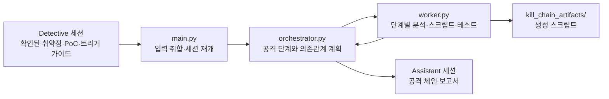

# Assistant

Detective 세션에서 확인한 취약점을 바탕으로 공격 체인을 분석하고 관련 스크립트를 생성합니다. 이 단계는 조사 결과와 재현 자료가 있는 경우에 사용합니다.

## 내부 흐름



스크립트 생성과 실행 성공은 구분합니다. 보고서의 체인 성공 여부는 기록된 실행·관찰 근거와 함께 검토해야 합니다.

```bash
python3 assistant/main.py --session path/to/detective-session
python3 assistant/main.py --session path/to/detective-session --resume path/to/assistant-session
```

`settings.json`에서 모델과 작업 수를 설정합니다. 오케스트레이터의 기본 추론 수준은 `medium`, 워커는 `high`입니다. 세션은 `sessions/assistant/`에, 생성된 스크립트는 `kill_chain_artifacts/`에 저장됩니다. 두 경로는 Git에서 제외됩니다.
