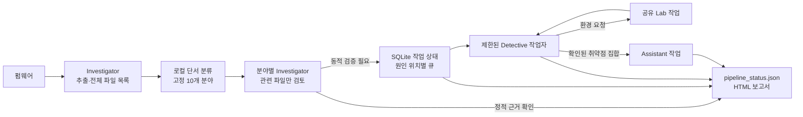

# Coordinator

Investigator, Detective, Lab, Assistant를 한 명령으로 연결합니다. Investigator는 펌웨어를 한 번 추출하고 모든 파일을 목록화합니다. 로컬 단서 분류 후 관련 분야의 전담 워커만 실행하며, 동적 검증이 필요한 위치를 저장 즉시 Detective에 전달합니다. Detective가 환경을 필요로 하면 Lab을 요청하고, 실행 근거로 확인된 취약점이 생기면 Assistant가 공격 체인을 분석합니다.



```bash
python3 coordinator/main.py path/to/firmware.bin
python3 coordinator/main.py path/to/firmware.bin --investigator-workers 3 --detective-workers 2
python3 coordinator/main.py path/to/firmware.bin --no-qemu
python3 coordinator/main.py path/to/firmware.bin --allow-network-research
```

상태는 `sessions/coordinator/<펌웨어 SHA256>/jobs.sqlite3`에 저장합니다. 전담 작업은 펌웨어·분야·파일·프롬프트 버전·작업 ID로, Detective는 펌웨어·원인 위치로 키를 정합니다. SQLite 트랜잭션과 작업별 파일 잠금으로 중복 실행을 막고, 같은 펌웨어의 동시 실행과 QEMU·Lab 공유 자원은 `sessions/.locks/`에서 잠급니다. 프로세스가 비정상 종료되면 운영체제가 잠금을 해제하며, 다음 실행에서 실패·부분 완료 작업을 다시 시도합니다. 완료된 전담 결과는 SQLite에서 재사용합니다. `--no-qemu`를 사용하면 QEMU와 Lab 환경 요청을 건너뜁니다.

Investigator와 Detective의 동시 실행 한도는 각각 `--investigator-workers`, `--detective-workers`로 지정합니다. Lab과 Assistant는 각각 최대 한 작업씩 실행하며, 호스트 포트를 쓰는 QEMU 시작과 Lab 설정은 공유 잠금으로 순서를 정합니다. `--research-minutes`와 `--max-iterations`는 Investigator에 적용됩니다. 이미 시작한 후속 단계의 종료 시간은 이 시간 예산에 포함되지 않습니다.

`pipeline_status.json`에는 단계별 대기·진행·완료·실패 건수, 첫 Detective 시작 시간, 연계 작업 완료 시간이 기록됩니다. Investigator 세션의 `scan_scope.json`에는 전체 파일 목록, 분야별 적용 상태, 파일별 라우팅 이유, 읽지 못한 항목의 이유가 있습니다. 통합 실행은 마지막에 HTML 보고서를 한 번 생성하며, 보고서에는 분야별 상태, 정적 근거 확인, Detective의 실행 재현 확인을 구분합니다. `적용 단서 없음`은 취약점 부재를 뜻하지 않습니다.

현재 Detective는 검증이 필요한 원인 위치마다 별도 세션을 만들며, Assistant는 그때까지 확인된 취약점 집합을 입력으로 받습니다. 같은 원인 위치가 여러 분야에서 발견돼도 Detective 작업은 하나만 생성합니다. Lab의 공유 런타임 테스트는 별도 잠금으로 직렬화합니다. 실제 QEMU 부팅과 서비스 준비 여부는 실행 증거가 필요합니다. CVE 적용 여부는 제품·버전·구성·영향 코드의 근거를 확인해야 하며, 네트워크 조회는 명시적으로 허용한 경우에만 외부 구성요소 담당에게 적용됩니다.
