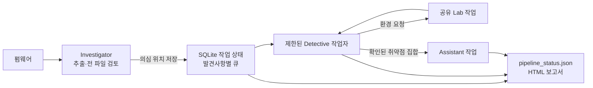

# Coordinator

Investigator, Detective, Lab, Assistant를 한 명령으로 연결합니다. Investigator가 펌웨어를 추출한 뒤 모든 일반 파일을 한 개씩 검토하고, 의심 위치가 저장되면 Detective가 백그라운드 작업으로 검증을 시작합니다. Detective가 동적 분석 환경을 필요로 하면 Lab 작업을 요청하고, 확인된 취약점이 있으면 Assistant가 공격 체인을 분석합니다.



```bash
python3 coordinator/main.py path/to/firmware.bin
python3 coordinator/main.py path/to/firmware.bin --investigator-workers 3 --detective-workers 2
python3 coordinator/main.py path/to/firmware.bin --no-qemu
python3 coordinator/main.py path/to/firmware.bin --allow-network-research
```

상태는 `sessions/coordinator/<펌웨어 SHA256>/jobs.sqlite3`에 저장합니다. 작업 종류와 입력 해시를 고유 키로 사용하고, SQLite 트랜잭션과 로컬 파일 잠금으로 중복 실행을 막습니다. 같은 펌웨어의 동시 실행과 QEMU·Lab 공유 자원은 `sessions/.locks/`에서 잠급니다. 프로세스가 비정상 종료되면 운영체제가 파일 잠금을 해제하며, 다음 실행에서 완료되지 않은 작업을 다시 시도합니다. `--no-qemu`를 사용하면 QEMU와 Lab 환경 요청을 건너뜁니다.

Investigator와 Detective의 동시 실행 한도는 각각 `--investigator-workers`, `--detective-workers`로 지정합니다. Lab과 Assistant는 각각 최대 한 작업씩 실행하며, 호스트 포트를 쓰는 QEMU 시작과 Lab 설정은 공유 잠금으로 순서를 정합니다. `--research-minutes`와 `--max-iterations`는 Investigator에 적용됩니다. 이미 시작한 후속 단계의 종료 시간은 이 시간 예산에 포함되지 않습니다.

`pipeline_status.json`에는 단계별 대기·진행·완료·실패 건수, 첫 Detective 시작 시간, 연계 작업 완료 시간이 기록됩니다. Investigator 세션의 `scan_scope.json`에는 파일 유형과 읽지 못한 항목의 이유가 있습니다. 통합 실행은 단계별 자동 HTML 생성을 건너뛰고 마지막에 한 번 보고서를 생성합니다. 이 보고서에는 검토 범위, 작업별 상태, Detective의 재현 확인 결과가 표시됩니다.

현재 Detective는 발견사항마다 별도 세션을 만들며, Assistant는 그때까지 확인된 취약점 집합을 입력으로 받습니다. Lab이 검증한 공유 런타임을 사용하는 테스트는 별도 잠금으로 직렬화합니다. 실제 QEMU 부팅과 서비스 준비 여부는 실행 증거가 필요합니다. CVE 적용 여부도 제품·버전·구성의 근거를 확인해야 하며, 네트워크 조회는 명시적으로 허용한 경우에만 Investigator 워커에서 수행합니다.
