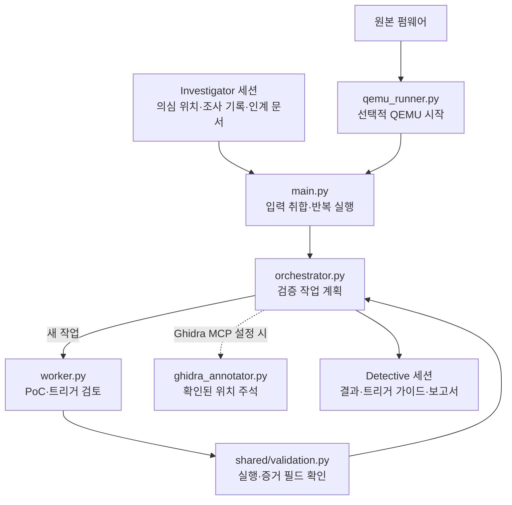

# Detective

Investigator 세션의 의심 위치와 심층 조사 기록을 읽고 재현 가능성을 검토합니다. 일반 요약 문자열이 비어 있어도 `suspected_findings`의 위치별 기록을 가져옵니다. 대화형 `/goal` 조사가 `research_artifacts/detective_handoff.md`를 남겼다면 그것도 입력으로 사용합니다. 설정에 따라 QEMU를 실행하고 결과와 재현 절차를 세션에 기록합니다.

## 내부 흐름



QEMU 실행은 선택 사항이며 프로세스 시작만으로 펌웨어 부팅이나 취약점 재현이 확인되지는 않습니다. 확인된 취약점으로 분류하려면 실제 테스트 실행과 관찰 증거가 워커 결과에 기록되어야 합니다. 이 검증은 기록의 일관성을 검사하며 테스트를 독립적으로 재실행하지는 않습니다.

```bash
python3 detective/main.py --session path/to/investigator-session --no-qemu
python3 detective/main.py --session path/to/investigator-session --firmware path/to/firmware.bin
```

`settings.json`의 기본 모델은 `gpt-6-sol`입니다. 오케스트레이터는 `medium`, 분석 워커와 Ghidra 주석 작업은 `high`를 사용합니다. 결과는 `sessions/detective/`에, 생성된 PoC 파일은 `poc_artifacts/`에 저장되며 두 경로는 Git에서 제외됩니다.

`qemu_runner.py`는 선택적 에뮬레이터 실행을, `ghidra_annotator.py`는 Ghidra MCP가 설정된 경우의 주석 작업을 담당합니다.
