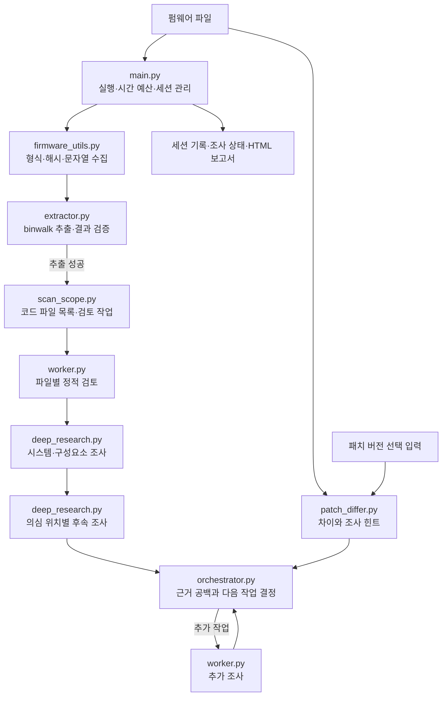

# Investigator

펌웨어의 형식과 문자열을 수집한 뒤 `binwalk --extract`로 세션 디렉터리에 추출합니다. 스크립트, 소스 파일, 실행 파일을 코드 검토 작업에 배정하고, 서비스·설정·구성요소를 조사합니다. 발견된 의심 위치마다 진입점, 데이터 흐름, 방어 조건, 반대 근거, 영향과 남은 의문을 확인하는 별도 작업을 실행합니다. 오케스트레이터는 이 기록을 검토한 뒤 추가 작업을 결정합니다. 이전 버전과 패치 버전도 선택적으로 비교할 수 있습니다.

통합 명령 `python3 coordinator/main.py`에서는 모든 일반 추출 파일을 한 개씩 검토하고, 의심 위치가 작업 로그에 저장되면 즉시 Detective 큐로 전달합니다. 개별 Investigator 명령은 기존 코드 파일 중심 검토 방식을 유지합니다.

## 내부 흐름



`main.py`가 추출 성공을 확인한 뒤 코드 검토, 기본 조사, 위치별 후속 조사를 순서대로 실행합니다. 그 결과를 보고 오케스트레이터가 추가 작업을 반복합니다. 패치 비교는 `--patched`를 준 경우에만 수행하며 조사 힌트로 사용합니다. 추출 실패 시에는 분석 작업을 시작하지 않습니다.

```bash
python3 investigator/main.py path/to/firmware.bin
python3 investigator/main.py path/to/old.bin --patched path/to/new.bin
python3 investigator/main.py path/to/firmware.bin --resume path/to/session
python3 investigator/main.py path/to/firmware.bin --research-minutes 45
python3 investigator/main.py path/to/firmware.bin --research-minutes 45 --allow-network-research
python3 investigator/main.py path/to/firmware.bin --resume path/to/session --research-minutes 45 --max-iterations 30
```

기본 모델, 병렬 작업 수, 추출 제한 시간, 검토 작업당 파일 수(`analysis.scan_files_per_task`), 심층 조사 활성화 여부와 시간 예산은 `settings.json`에서 설정합니다. 오케스트레이터는 `medium`, 분석 워커는 `high` 추론 수준을 기본으로 사용합니다. `--research-minutes`는 이번 실행에서 새 작업을 시작할 수 있는 최대 시간을 정합니다. 진행 중인 Codex 작업은 끝날 때까지 기다리므로 실제 소요 시간은 이보다 길 수 있습니다. 기본값 `0`은 시간 제한이 없습니다. 조사 범위가 남으면 같은 세션을 `--resume`으로 이어갈 수 있습니다. 세션의 반복 횟수 한도에 도달했다면 `--max-iterations`를 더 큰 값으로 지정합니다.

워커는 기본적으로 세션 디렉터리에서 `workspace-write`로 실행되어 `research_artifacts/`에 분석 파일을 만들 수 있습니다. 원본 펌웨어와 추출 파일은 수정하지 않도록 지시합니다. 네트워크는 기본적으로 꺼져 있으며, 외부 1차 자료를 조회하려면 `--allow-network-research`를 지정합니다. 실행 재현이나 라이브 대상 접근 권한을 부여하는 옵션은 아닙니다.

세션에는 추출 매니페스트 `extraction.json`, 코드 검토 범위 `scan_scope.json`, 시간·진행 상태 `research_status.json`, 대화형 Codex용 `GOAL_PROMPT.txt`가 저장됩니다. `/goal`은 Codex의 대화형 스레드 기능이므로 자동 실행의 `codex exec` 안에서 켜지지 않습니다. 더 조사하려면 Codex 대화형 세션을 열고 `GOAL_PROMPT.txt`의 한 줄을 붙여 넣으세요. 추가 조사는 `research_artifacts/audit.md`와 `research_artifacts/detective_handoff.md`에 기록하도록 요청하며, 후자는 Detective가 입력으로 읽습니다. 파일 검토 기록은 취약점 부재를 보증하지 않으며, 분석되지 않은 파일 수는 보고서에 표시됩니다.

`main.py`는 실행 흐름과 시간 예산, `extractor.py`는 추출 및 결과 검증, `scan_scope.py`는 코드 파일 탐지와 검토 작업 생성, `deep_research.py`는 시스템·위치별 심층 조사 작업, `orchestrator.py`는 후속 작업 계획, `worker.py`는 개별 Codex 분석을 담당합니다. `firmware_utils.py`는 바이너리 기본 정보를 수집하고 `patch_differ.py`는 두 펌웨어의 차이를 계산합니다.
