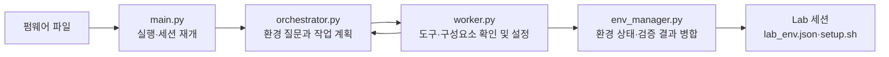

# Lab

펌웨어의 구조를 확인하고 QEMU, 디버거, 네트워크 연결 등 동적 분석에 필요한 환경을 구성합니다. 환경 정보와 재현 스크립트는 세션에 저장됩니다.

## 내부 흐름



`setup.sh`는 워커가 반환한 설정 절차를 모은 재현용 스크립트입니다. 환경이 실제로 동작하는지는 `lab_env.json`의 검증 결과에서 확인해야 합니다.

```bash
python3 lab/main.py path/to/firmware.bin
python3 lab/main.py path/to/firmware.bin --resume path/to/lab-session
```

`settings.json`에서 출력 경로와 실행 설정을 바꿀 수 있습니다. 기본 모델은 `gpt-6-sol`이며 오케스트레이터는 `medium`, 워커는 `high` 추론 수준을 사용합니다. 결과는 `sessions/lab/`에 저장됩니다.

`env_manager.py`는 워커가 반환한 환경 정보를 합치고 `lab_env.json`과 `setup.sh`를 작성합니다.
