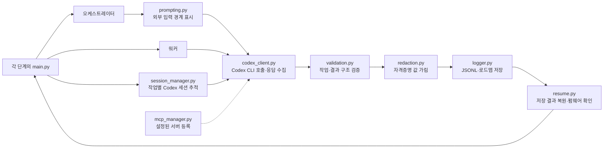

# Shared

여러 단계에서 함께 쓰는 코드입니다.

## 공통 실행 흐름

각 단계는 필요한 공통 함수를 직접 호출합니다. 그림은 데이터와 세션 관리의 대표적인 경로이며, 모든 호출이 이 순서로 발생한다는 뜻은 아닙니다.

- `codex_client.py`: Codex CLI 실행과 세션 ID 추출
- `validation.py`: 작업 계획 및 워커 결과 검증
- `redaction.py`: 일반적인 자격증명 값과 개인키 블록을 저장·보고 전에 가림
- `version.py`: FBI 2.0 버전 문자열을 CLI에서 공통으로 사용
- `resume.py`: 저장된 작업 결과 복원
- `prompting.py`: 펌웨어·세션 자료의 입력 경계 표시
- `logger.py`: 오케스트레이터 및 워커 대화 기록
- `session_manager.py`: 워커 작업과 Codex 세션 연결
- `mcp_manager.py`: 설정된 MCP 서버 등록

오케스트레이터의 호출은 `medium`, 분석 작업의 호출은 `high`를 기본으로 사용합니다. 호출 결과와 세션 ID는 각 단계의 로그에 저장됩니다.
